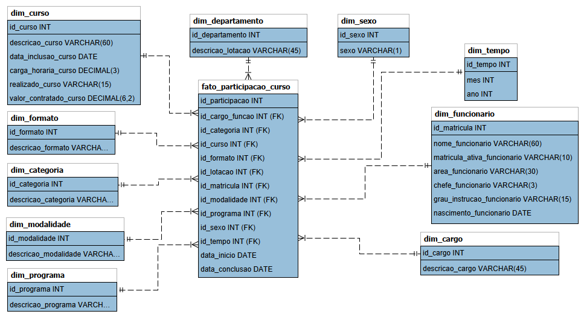

# Projeto de BI: Educação Corporativa - SENAC

## Sobre
Este projeto é uma experiência prática de Ciência de Dados em que analisamos três datasets contendo dados sobre funcionários de uma instituição de ensino (SENAC), cursos ofertados e um histórico de participações.

## Objetivo
Desenvolver as nossas habilidades de análise, engenharia, ciência e visualização de dados ao passo em que verificamos se as métricas que escolhemos podem ou não ser medidas e acompanhadas com base nos dados que recebemos e quais decisões podem ser tomadas a partir delas.

## A FAZER:
1. Definir as métricas que ficarão em 
2. Em  criar a Dimensão Funcionário, executar e debugar o código.